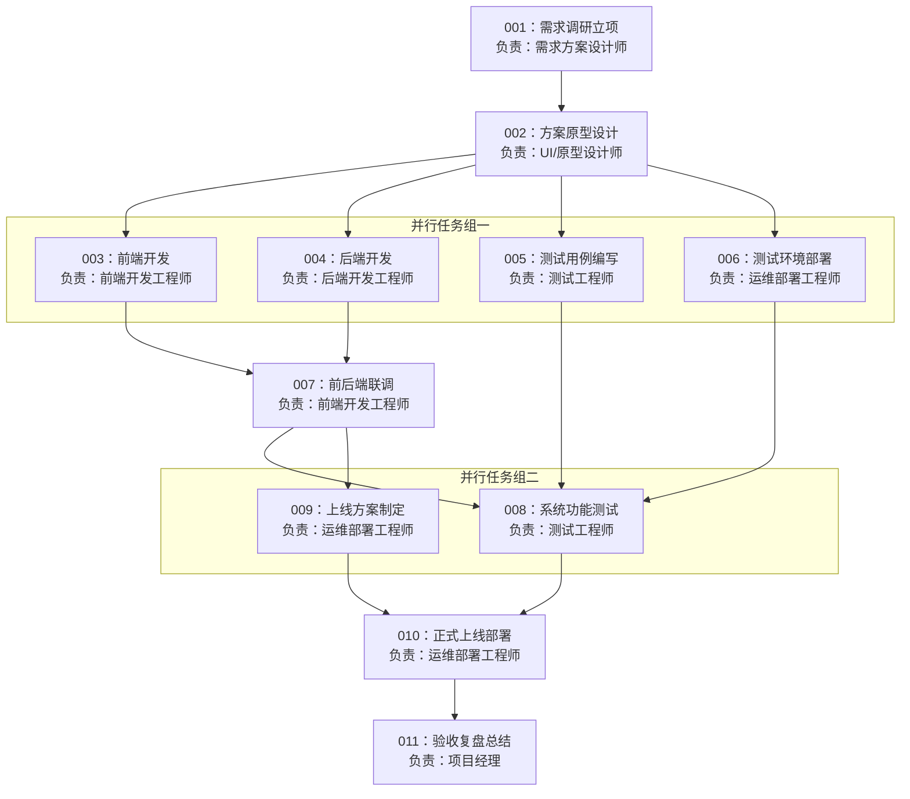

# Multi-Agents

> 基于 LangGraph 构建的多智能体协作系统，使用 LangChain Core 基础设施实现各智能体能力，追求轻量、可控、易扩展。

---

## 项目简介

本项目是前代 `multi_agents` 的延续与重构。核心思路是将一个复杂任务的完整生命周期——从意图识别、任务规划、质量审核，到并行调度执行、结果汇总——拆分给职责清晰的智能体分层承担，形成一条可靠的流水线。

**为什么不直接用 LangChain 的高层 API（如 `create_agent`）？**

1. **工程能力锻炼**：主动放弃便捷封装，仅使用 LangChain Core 的基础类进行设计，以培养底层工程化思维。
2. **性能考量**：实测中高层 API 较为臃肿，通过自主设计可针对实际场景做定制优化。

> **重构说明**：`agents/` 下的现有代码处于过渡期，不代表最终设计，以本文档为准。

---

## 架构总览

```
用户输入
   ↓
┌─────────────────────────────────┐
│  Dispatcher（分拣层）            │  判断是闲聊还是任务；任务才往下走
└─────────────────────────────────┘
   ↓ 任务
┌─────────────────────────────────┐
│  Planner（规划层）               │  理解目标 → 拆解子任务 → 输出 DAG 规划表
└─────────────────────────────────┘
   ↓ 规划草稿
┌─────────────────────────────────┐
│  Reviewer（审核层）              │  检查规划质量，不合格直接打回 Planner 重做
└─────────────────────────────────┘
   ↓ 审核通过
┌─────────────────────────────────┐
│  Scheduler（调度层）             │  扫描 DAG → 找可执行节点 → 并行派发 Worker
│                         ↑       │  Worker 回报 → 更新节点状态 → 继续或结束
└─────────────────────────────────┘
   ↓ / ↑
┌─────────────────────────────────┐
│  Workers（执行层）               │  各司其职，结果写入对应任务节点的 output
└─────────────────────────────────┘
   ↓ 全部节点完成
Reporter → END
```

**两个核心设计原则：**

1. **计划与执行分离**：Planner 的产出是显式的 DAG 规划表，Scheduler 只读 DAG 行动，不自行判断
2. **强制审核关卡**：Reviewer 是架构层的硬约束，规划未通过审核则打回重做，不依赖 LLM 自由裁量

---

## 各层职责

| 角色 | 类型 | 接收 | 产出 |
|---|---|---|---|
| **Dispatcher** | 路由节点 | 用户输入 | 闲聊直接回复 / 任务传递给 Planner |
| **Planner** | LLM 节点 | 用户任务 + Reviewer 反馈（重规划时）| DAG 规划表 |
| **Reviewer** | LLM 节点 | DAG 规划表 + 原始任务 | 审核通过 / 意见反馈（打回 Planner）|
| **Scheduler** | 路由节点 | 审核通过的 DAG | 触发 Worker 执行 / 汇聚结果 |
| **Worker** | LLM 节点 | 任务描述 + 前置输入 | 执行结果（写入 DAG 节点 output）|
| **Reporter** | LLM 节点 | 所有 Worker 输出聚合 | 最终报告 |

---

## 核心数据结构

### 任务状态枚举

```python
class TaskStatus(str, Enum):
    PENDING  = "pending"   # 等待前置任务完成
    READY    = "ready"     # 前置任务已完成，等待执行
    RUNNING  = "running"   # 正在执行
    DONE     = "done"      # 已完成
    FAILURE  = "failure"   # 执行失败
```

### DAG 任务节点

```python
class TaskNode(BaseModel):
    task_id:      str                    # 任务 ID
    worker:       Optional[WorkerName]   # 负责执行的 Worker
    description:  str                    # 任务描述
    dependencies: list[str]              # 前置任务 ID 列表
    status:       TaskStatus             # 当前状态
    input_from:   list[str]              # 输入来源（前置任务 ID）
    input_data:   list[str]              # 实际输入数据（由 Scheduler 填充）
    output:       Optional[str]          # 执行结果
```

### 全局 Graph 状态

```python
class GraphState(TypedDict):
    # 长期记忆（跨轮对话保留）
    messages_history: Annotated[list[BaseMessage], add_messages]
    # 任务级记忆（任务结束后销毁）
    intent_judge:    NotRequired[Literal["chat", "task"]]
    chat_reply:      NotRequired[str]
    task:            NotRequired[str]
    plan:            NotRequired[DAG]
    review:          NotRequired[str]
    is_return:       NotRequired[bool]
    return_count:    NotRequired[int]    # Reviewer 打回次数，上限为 5
    reviewed_plan:   NotRequired[DAG]
    workers_output:  NotRequired[list[WorkerOutput]]
    report:          NotRequired[str]
```

---

## DAG 示例

以一个完整的软件项目开发流程为例：



---

## Scheduler 调度机制

Scheduler 采用**事件驱动 + 扫描轮询**的方式动态调度任务：

1. 收到审核通过的 DAG，扫描所有节点，将 `dependencies` 为空的节点标为 `READY`，批量触发
2. 每当一个 Worker 完成并回调后，重新扫描未完成节点的 `dependencies`
3. 若某节点的所有前置任务均为 `DONE`，则标为 `READY` 并触发执行
4. 重复上述过程直到所有节点完成，结果聚合后转交 Reporter

> LangGraph 中多节点并行合并时存在状态竞争，通过 `add_messages` 等 reducer 机制处理。

---

## 关键设计决策

### Planner 如何规范输出 DAG？

| 方案 | 描述 | 评价 |
|---|---|---|
| `with_structured_output` | LangChain 结构化输出约束 | 高效，依赖模型能力 |
| Prompt 约束 | 通过提示词规范输出格式 | 灵活，稳定性稍弱 |
| 工具调用 | LLM 逐个调用工具创建节点 | 最可靠，但耗时和 token 消耗较大 |

**当前策略**：方案 1 + 2 结合使用。

### 任务执行失败如何处理？

| 方案 | 描述 |
|---|---|
| 终止 DAG | 遇到失败直接终止整个流程 |
| SKIPPED 状态 | 跳过失败任务，继续执行后续独立节点 |
| 人工干预 | 询问用户是否重试该任务（**当前倾向方案**）|

---

## Worker 系统

Worker 设计沿用**模板方法模式**，骨架固定，差异通过钩子实现。

```
BaseWorker
├── name / description / prompt / tools / model_config（子类声明）
├── create_context()   → WorkerContext（可覆盖）
├── build_input()      → List[Message]（可覆盖）
├── on_tool_result()   → 工具结果处理（可覆盖）
└── run()              → 不可覆盖，执行骨架
```

新增 Worker 只需声明四个字段 + Registry 注册，零改动旧代码：

```python
class MyWorker(BaseWorker):
    name = "my_worker"
    description = "描述这个 Worker 的用途，供 Planner 感知"
    prompt = my_prompt
    tools = [some_tool]
    model_config = chat_model

WorkerRegistry.register(MyWorker())
```

> `WorkerRegistry` 支持运行时动态注册，为后续「按需创建 Worker」功能预留接口。

---

## 目录结构

```
multi-agents/
├── Models/
│   ├── base.py                  # BaseModel 基类
│   └── deepseek.py              # DeepseekChatModel + 模块级单例
│
├── agents/
│   ├── state.py                 # 所有数据结构：TaskNode / DAG / GraphState 等
│   ├── base_worker.py           # BaseWorker + WorkerContext
│   ├── worker_registry.py       # WorkerRegistry
│   │
│   ├── pipeline/                # 非 Worker 角色（分析-审核-调度管线）
│   │   ├── dispatcher.py
│   │   ├── planner.py
│   │   ├── reviewer.py
│   │   └── scheduler.py
│   │
│   └── workers/                 # 执行层 Worker
│       ├── researcher.py
│       ├── engineer.py
│       ├── reporter.py
│       └── chatter.py
│
├── tools/
│   └── web_tools.py
│
├── graph.py                     # 纯拓扑配置
└── main.py
```

---

## 变化点隔离

| 想改什么 | 改哪里 | 影响范围 |
|---|---|---|
| 执行骨架、错误处理 | `BaseWorker.run` | 所有 Worker 自动生效 |
| 某 Worker 的特殊逻辑 | 对应钩子方法 | 只影响该 Worker |
| 新增 Worker | 新建类 + Registry 注册 | 零改动旧代码 |
| Reviewer 审核标准 | `reviewer.py` 的 prompt | 只影响审核层 |
| Planner 规划策略 | `planner.py` 的 prompt | 只影响规划层 |
| 切换模型 | `Models/` 对应配置 | 一处生效 |
| Graph 拓扑 | `graph.py` | 只影响流向 |

---

## 扩展路径

**当前阶段**：单 Planner 生成完整 DAG，Scheduler 按依赖关系动态调度。

**下一阶段**：Worker 数量增多时，Planner 可拆分为 Director + 多个子 Planner 并行分析，汇总后统一出 DAG。

**未来**：`WorkerRegistry` 支持运行时动态注册，实现「按需创建 Worker」。

---

## 技术栈

- **[LangGraph](https://github.com/langchain-ai/langgraph)** — 多智能体工作流管理
- **[LangChain Core](https://github.com/langchain-ai/langchain)** — 基础设施（Messages、BaseModel 等）
- **[Pydantic](https://docs.pydantic.dev/)** — 数据结构与校验
- **Python 3.11+**

---

## License

MIT
