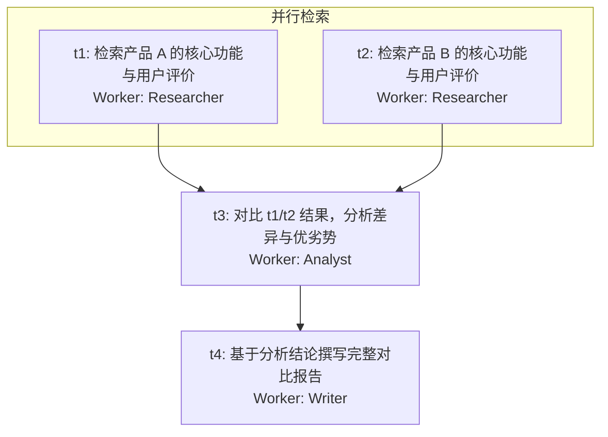

# Multi-Agents

> 基于 LangGraph 构建的多智能体研究报告生成框架，使用 LangChain Core 基础设施实现各智能体能力，追求轻量、可控、易扩展。

---

## 项目定位

本项目是一套以**深度研究报告自动生成**为核心应用方向的多智能体编排框架。

用户输入一个研究类任务（如"对比分析 A 和 B 的市场竞争格局"），系统自动完成：
1. **意图识别**：判断是闲聊还是需要执行的研究任务
2. **规划**：将任务拆解为带依赖关系的 DAG，并联网检索证实可行
3. **审核**：对规划质量进行硬约束审核，不合格打回重做
4. **并行执行**：按 DAG 拓扑顺序，并行驱动多个 Worker 检索、分析
5. **报告生成**：将所有产出汇总为结构化 Markdown 报告

**与 GPT-Researcher 等同类项目的核心差异**：

| 维度 | 本项目 | GPT-Researcher |
|---|---|---|
| 研究规划 | LLM 生成显式 DAG + Reviewer 审核打回 | 固定流程（平铺子问题并发） |
| 并行方式 | DAG 拓扑依赖并行，支持有因果链的研究 | 所有子问题完全平行，无依赖建模 |
| 质量门控 | Reviewer 硬约束关卡，规划不合格不执行 | 无，依赖 LLM 自由发挥 |
| 搜索引擎 | 本地 SearXNG（私有、无审查、可定制） | Tavily/DuckDuckGo 等外部 API |
| 扩展方式 | Worker 注册制，零改动旧代码新增角色 | 固定角色，扩展成本较高 |

---

## 架构总览

```
用户输入
   ↓
┌─────────────────────────────────┐
│  Dispatcher（分拣层）            │  判断是闲聊还是任务；任务才往下走
└─────────────────────────────────┘
   ↓ 任务
┌─────────────────────────────────┐
│  Planner（规划层）               │  理解目标 → 拆解子任务 → 输出 DAG 规划表
└─────────────────────────────────┘
   ↓ 规划草稿
┌─────────────────────────────────┐
│  Reviewer（审核层）              │  检查规划质量，不合格直接打回 Planner 重做
└─────────────────────────────────┘
   ↓ 审核通过
┌─────────────────────────────────┐
│  Scheduler（调度层）             │  扫描 DAG → 找可执行节点 → 并行派发 Worker
│                         ↑       │  Worker 回报 → 更新节点状态 → 继续或结束
└─────────────────────────────────┘
   ↓ / ↑
┌─────────────────────────────────┐
│  Workers（执行层）               │  各司其职，结果写入对应任务节点的 output
└─────────────────────────────────┘
   ↓ 全部节点完成
Reporter → END
```

**两个核心设计原则：**

1. **计划与执行分离**：Planner 的产出是显式的 DAG 规划表，Scheduler 只读 DAG 行动，不自行判断
2. **强制审核关卡**：Reviewer 是架构层的硬约束，规划未通过审核则打回重做，不依赖 LLM 自由裁量

---

## 各层职责

| 角色 | 类型 | 接收 | 产出 |
|---|---|---|---|
| **Dispatcher** | 路由节点 | 用户输入 | 闲聊直接回复 / 任务传递给 Planner |
| **Planner** | LLM 节点 | 用户任务 + Reviewer 反馈（重规划时）| DAG 规划表 |
| **Reviewer** | LLM 节点 | DAG 规划表 + 原始任务 | 审核通过 / 意见反馈（打回 Planner）|
| **Scheduler** | 路由节点 | 审核通过的 DAG | 触发 Worker 执行 / 汇聚结果 |
| **Worker** | LLM 节点 | 任务描述 + 前置输入 | 执行结果（写入 DAG 节点 output）|
| **Reporter** | LLM 节点 | 所有 Worker 输出聚合 | 最终 Markdown 报告 |

---

## Worker 系统

### 已规划的 Worker（研究报告方向）

#### 🔍 Researcher（信息检索员）
- **职责**：针对单一明确的子问题执行搜索 + 精读网页，如实输出结构化原始信息摘要
- **定位**：DAG 中并行叶子节点的主要执行者，只做信息收集，不做分析判断
- **工具**：`searxng_search`、`fetch_webpage`、`save_note`

#### 📊 Analyst（数据分析师）
- **职责**：接收一个或多个 Researcher 的输出，执行对比、归纳、推理，产出有观点的分析结论
- **定位**：DAG 中"汇聚节点"的执行者，`dependencies` 通常包含多个 Researcher 任务
- **工具**：`python_code_box`、`save_note`

#### ✍️ Writer（报告撰写员）
- **职责**：接收所有分析结论，按摘要/正文/结论结构撰写完整可读的 Markdown 报告
- **定位**：DAG 末尾节点，`dependencies` 覆盖所有上游分析节点，不做搜索和计算
- **工具**：`read_notes`、`save_report`

### Worker 代码结构

Worker 设计沿用**模板方法模式**，骨架固定，差异通过字段声明实现。

```
BaseWorker
├── name / description / prompt / tools / model_config（子类声明）
├── create_context()   → WorkerContext（可覆盖）
├── build_input()      → List[Message]（可覆盖）
├── on_tool_result()   → 工具结果处理（可覆盖）
└── run()              → 不可覆盖，执行骨架
```

新增 Worker 只需声明字段 + Registry 注册，零改动旧代码：

```python
class ResearchWorker(BaseWorker):
    name = "researcher"
    description = "针对单一子问题执行网络检索，输出结构化信息摘要"
    prompt = researcher_prompt
    tools = [searxng_search, fetch_webpage, save_note]
    model_config = chat_model

WorkerRegistry.register(ResearchWorker())
```

---

## 工具清单

| 工具名 | 文件 | 状态 | 归属 Worker | 说明 |
|---|---|---|---|---|
| `searxng_search` | `tools/web_tools.py` | ✅ 已完成 | Researcher | SearXNG 本地搜索，返回标题/URL/摘要 |
| `fetch_webpage` | `tools/web_tools.py` | ✅ 已完成 | Researcher | 精读网页全文（截取 4000 字符） |
| `python_code_box` | `sandbox/box_langchain.py` | ✅ 已完成 | Analyst | Python 代码执行沙盒，支持数值计算 |
| `save_note` | `tools/note_tools.py` | 🔲 待实现 | Researcher / Analyst | 以 task_id 为键持久化存储笔记内容 |
| `read_notes` | `tools/note_tools.py` | 🔲 待实现 | Writer | 按 task_id 列表读取笔记，汇总输入 |
| `save_report` | `tools/note_tools.py` | 🔲 待实现 | Writer | 将最终报告输出为 Markdown 文件 |

---

## DAG 示例

以"对比分析两款产品并生成报告"为例：



t1 和 t2 并行执行；t3 等待两者完成后做对比分析；t4 等待 t3 完成后撰写报告。

---

## 核心数据结构

### 任务状态枚举

```python
class TaskStatus(str, Enum):
    PENDING  = "pending"   # 等待前置任务完成
    READY    = "ready"     # 前置任务已完成，等待执行
    RUNNING  = "running"   # 正在执行
    DONE     = "done"      # 已完成
    FAILURE  = "failure"   # 执行失败
```

### DAG 任务节点

```python
class TaskNode(BaseModel):
    task_id:      str                    # 任务 ID
    worker:       Optional[WorkerName]   # 负责执行的 Worker
    description:  str                    # 任务描述
    dependencies: list[str]              # 前置任务 ID 列表
    status:       TaskStatus             # 当前状态
    input_from:   list[str]              # 输入来源（前置任务 ID）
    input_data:   list[str]              # 实际输入数据（由 Scheduler 填充）
    output:       Optional[str]          # 执行结果
```

### WorkerName 枚举（研究报告方向）

```python
class WorkerName(str, Enum):
    researcher = "researcher"   # 信息检索员
    analyst    = "analyst"      # 数据分析师
    writer     = "writer"       # 报告撰写员
```

### 全局 Graph 状态

```python
class GraphState(TypedDict):
    # 长期记忆（跨轮对话保留）
    messages_history: Annotated[list[BaseMessage], add_messages]
    # 任务级记忆（任务结束后销毁）
    user_input:      str
    intent_judge:    NotRequired[Literal["chat", "task"]]
    chat_reply:      NotRequired[str]
    task:            NotRequired[str]
    plan:            NotRequired[DAG]
    review:          NotRequired[str]
    is_return:       NotRequired[bool]
    return_count:    NotRequired[int]
    reviewed_plan:   NotRequired[DAG]
    workers_output:  NotRequired[list[WorkerOutput]]
    report:          NotRequired[str]
    # 角色任务级对话记忆
    planner_messages:  NotRequired[list[BaseMessage]]
    reviewer_messages: NotRequired[list[BaseMessage]]
```

---

## Scheduler 调度机制

Scheduler 采用**事件驱动 + 扫描轮询**的方式动态调度任务：

1. 收到审核通过的 DAG，扫描所有节点，将 `dependencies` 为空的节点标为 `READY`，批量触发
2. 每当一个 Worker 完成并回调后，重新扫描未完成节点的 `dependencies`
3. 若某节点的所有前置任务均为 `DONE`，则标为 `READY` 并触发执行
4. 重复上述过程直到所有节点完成，结果聚合后转交 Reporter

> LangGraph 中多节点并行合并时存在状态竞争，通过 `add_messages` 等 reducer 机制处理。

---

## 关键设计决策

### Planner 如何规范输出 DAG？

| 方案 | 描述 | 评价 |
|---|---|---|
| `with_structured_output` | LangChain 结构化输出约束 | 高效，依赖模型能力 |
| Prompt 约束 | 通过提示词规范输出格式 | 灵活，稳定性稍弱 |
| 工具调用 | LLM 通过调用 `structured_output_tool` 强制产出结构 | 最可靠，**当前采用方案** |

**当前策略**：工具调用（`structured_output_tool`）+ Prompt 约束结合，Planner 必须通过调用工具来结束任务，确保输出始终是合法的 `DAG` Pydantic 对象。

### 任务执行失败如何处理？

| 方案 | 描述 |
|---|---|
| 终止 DAG | 遇到失败直接终止整个流程 |
| SKIPPED 状态 | 跳过失败任务，继续执行后续独立节点 |
| 人工干预 | 询问用户是否重试该任务（**当前倾向方案**）|

---

## 当前完成状态

| 模块 | 状态 | 说明 |
|---|---|---|
| Dispatcher | ✅ 完成 | 意图分拣，chat/task 路由 |
| Planner | ✅ 完成 | DAG 生成 + 无环检测 + 重试机制 |
| Reviewer | ✅ 完成 | 五维审核 + 打回计数上限 |
| Scheduler | 🔲 待实现 | DAG 拓扑调度 + Worker 并行分发 |
| Researcher Worker | 🔲 待实现 | 检索 + 笔记存储 |
| Analyst Worker | 🔲 待实现 | 对比分析 + 数值计算 |
| Writer Worker | 🔲 待实现 | 报告撰写 + 文件输出 |
| Reporter | 🔲 待实现 | Worker 输出汇总 → 最终报告 |
| note_tools | 🔲 待实现 | save_note / read_notes / save_report |

---

## 目录结构

```
multi-agents/
├── Cores/
│   ├── Agents/
│   │   └── Base.py              # BaseAgent：工具绑定 + 自循环执行骨架
│   ├── Models/
│   │   ├── Base.py              # BaseChatModel 基类
│   │   ├── Deepseek.py          # DeepSeek 模型封装
│   │   └── model.py             # chat_model / reasoner_model 模块级单例
│   ├── Prompts/
│   │   ├── dispatcher.py        # Dispatcher 提示词
│   │   ├── planner.py           # Planner 提示词
│   │   └── reviewer.py          # Reviewer 提示词
│   └── States/
│       └── structs.py           # 所有数据结构：TaskNode / DAG / GraphState 等
│
├── three_departments/           # 管线层（Dispatcher / Planner / Reviewer / Scheduler）
│   ├── dispatcher.py
│   ├── planner.py
│   ├── reviewer.py
│   ├── scheduler.py             # 🔲 待实现
│   └── reporter.py              # 🔲 待实现
│
├── workers/                     # 执行层 Worker（🔲 待建立）
│   ├── researcher.py
│   ├── analyst.py
│   └── writer.py
│
├── tools/
│   ├── web_tools.py             # searxng_search / fetch_webpage
│   └── note_tools.py            # 🔲 save_note / read_notes / save_report
│
├── sandbox/
│   └── box_langchain.py         # python_code_box
│
├── searxng/                     # SearXNG 本地搜索引擎配置
├── docker-compose.yml
├── graph.py                     # 主 Graph 拓扑配置
├── main.py
└── requirements.txt
```

---

## 扩展路径

**当前阶段**：三 Worker（Researcher / Analyst / Writer）覆盖研究报告完整链路。

**下一阶段**：Worker 数量增多时，Planner 可拆分为 Director + 多个子 Planner 并行分析，汇总后统一出 DAG。

**未来**：`WorkerRegistry` 支持运行时动态注册，实现「按需创建 Worker」，框架可平移至其他垂直领域（如代码生成、数据分析流水线）。

---

## 为什么不直接用 LangChain 高层 API？

1. **工程能力锻炼**：主动放弃便捷封装，仅使用 LangChain Core 的基础类进行设计，培养底层工程化思维。
2. **性能考量**：高层 API 较为臃肿，通过自主设计可针对实际场景做定制优化。
3. **可控性**：显式的 DAG + 强制审核关卡，比高层 API 的黑盒执行更可预期、更易调试。

---

## 技术栈

- **[LangGraph](https://github.com/langchain-ai/langgraph)** — 多智能体工作流管理
- **[LangChain Core](https://github.com/langchain-ai/langchain)** — 基础设施（Messages、BaseModel 等）
- **[Pydantic](https://docs.pydantic.dev/)** — 数据结构与校验
- **[SearXNG](https://github.com/searxng/searxng)** — 本地私有搜索引擎
- **Python 3.11+**

---

## License

MIT
